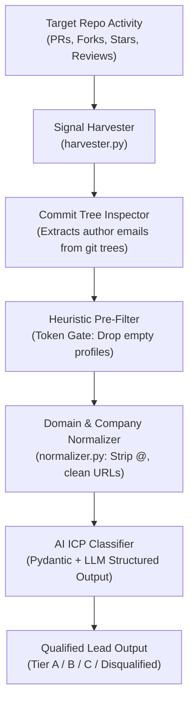

# ⚡ Star-to-Pipeline: Open-Source GitHub PLG Revenue Engine

An automated Go-To-Market (GTM) data pipeline that turns open-source developer activity (stars, forks, PRs, reviews) into qualified enterprise sales pipeline.

Commercial tools like **Common Room**, **Koala**, and **Pocus** charge startups **$15,000 to $40,000/year** for this capability. This project implements the core engine from scratch in Python.

---

## 🎯 The Business Problem

Developer tool and open-source companies (e.g., Supabase, PostHog, LangChain, Prisma) have tens of thousands of GitHub stars and contributors. However, sales and growth teams face two massive bottlenecks:

1. **The Email Black Hole:** Over 80% of developers keep their email address private on their public GitHub profile.
2. **The Noise Ratio:** 90%+ of repository activity comes from students, hobbyists, job seekers, or internal company employees. Sales reps waste dozens of hours manually vetting profiles.

**Star-to-Pipeline** automates the entire discovery, enrichment, heuristic filtering, and AI ICP qualification workflow in under 60 seconds.

---

## 🏗️ System Architecture



---

## ⚡ Key Engineering Highlights

### 1. The Commit Tree Inspector (Uncovering Hidden Emails)
When developers run `git commit`, their Git client embeds their author email into the Git tree object. Even if a developer's public GitHub profile has `email: null`, this engine inspects their public Git commit and push events to uncover verified corporate and personal emails.

### 2. Heuristic Pre-Filtering (The Token Gate)
Sending every raw profile to an LLM wastes API budget. The pipeline uses deterministic code gates to discard anonymous profiles (lacking company, domain, or email) before calling AI models, saving **60–80% in token costs**.

### 3. Normalization Engine (`normalizer.py`)
Cleans messy developer strings:
* Strips leading `@` and corporate suffixes (`", Inc."`, `", LLC"`).
* Distinguishes free email providers (`@gmail.com`) from corporate domains (`@marmelab.com`).
* Strips protocols and query parameters from personal websites to yield root domains.

### 4. Pydantic-Governed LLM ICP Classification (`pipeline.py`)
Uses structured prompt engineering and Pydantic models to classify leads into objective tiers:
* **Tier A (Enterprise / High Intent):** Founders, VPs, and Engineering Leads at commercial companies.
* **Tier B (Mid-Market / SMB):** Senior developers at established digital agencies and software firms.
* **Tier C (Individual / Freelancer):** Solo consultants and hobby projects.
* **Disqualified:** Automatically detects and filters **internal employees, academic students, and job seekers**.

---

## 🧪 Real-World Test Output (Scanned on `supabase/supabase`)

Here is live output from running the pipeline against real activity on Supabase:

```json
// 1. AUTO-DISQUALIFIED: Internal Employee
{
  "name": "Barry Roodt",
  "username": "barryroodt",
  "company": "Supabase",
  "signal_type": "PullRequestEvent",
  "tier": "Disqualified",
  "confidence": "High",
  "reasoning": "Barry Roodt is an AI Tooling Engineer at Supabase, indicating this is an internal employee contribution with zero commercial buyer intent.",
  "suggested_action": "Archive"
}

// 2. AUTO-DISQUALIFIED: Job Seeker
{
  "name": "Mangesh Raut",
  "username": "mangeshraut712",
  "company": null,
  "tier": "Disqualified",
  "confidence": "High",
  "reasoning": "The lead lists no associated company and explicitly states they are 'Open to Software Engineer roles' in their bio, identifying them as an active job seeker with no commercial purchasing intent.",
  "suggested_action": "Archive"
}

// 3. AUTO-DISQUALIFIED: Student
{
  "name": "hasithasandun",
  "username": "hasithasandunlakshan",
  "company": null,
  "tier": "Disqualified",
  "confidence": "High",
  "reasoning": "The lead explicitly identifies as an 'Engineering Undergraduate at University of Moratuwa'... active student status indicates an absence of enterprise commercial buying intent.",
  "suggested_action": "Archive"
}

// 4. QUALIFIED REVENUE LEAD: High-Value Agency Buyer!
{
  "name": "Gildas Garcia",
  "username": "djhi",
  "company": "Marmelab",
  "website": "marmelab.com",
  "signal_type": "PullRequestReviewEvent",
  "tier": "Tier B",
  "confidence": "High",
  "reasoning": "Gildas is an experienced developer active since 2000 and currently working at Marmelab, an established digital product agency. This places him as a senior developer at a recognizable agency, fitting the Mid-Market / SMB profile.",
  "suggested_action": "Add to Cold Sequence"
}
```

---

## 🚀 Setup & Execution

### 1. Prerequisites
* Python 3.11+
* GitHub Personal Access Token (Optional, for 5,000 req/hr limit)

### 2. Installation
```bash
git clone https://github.com/Sameer330/star-pipeline-gtm.git
cd star-pipeline-gtm

python3 -m venv venv
source venv/bin/activate
pip install -r requirements.txt
```

### 3. Configure Environment
Create a `.env` file:
```env
GITHUB_TOKEN=your_github_personal_access_token_here
```

### 4. Run the Pipeline
```bash
python3 pipeline.py
```

---

## 🛠️ Tech Stack
* **Language:** Python 3.11+
* **Validation & Schemas:** Pydantic v2
* **Networking & Async:** `httpx`, `asyncio`
* **AI Orchestration:** Pydantic Structured Outputs + Prompt Engineering
* **Data Sources:** GitHub REST API v3
